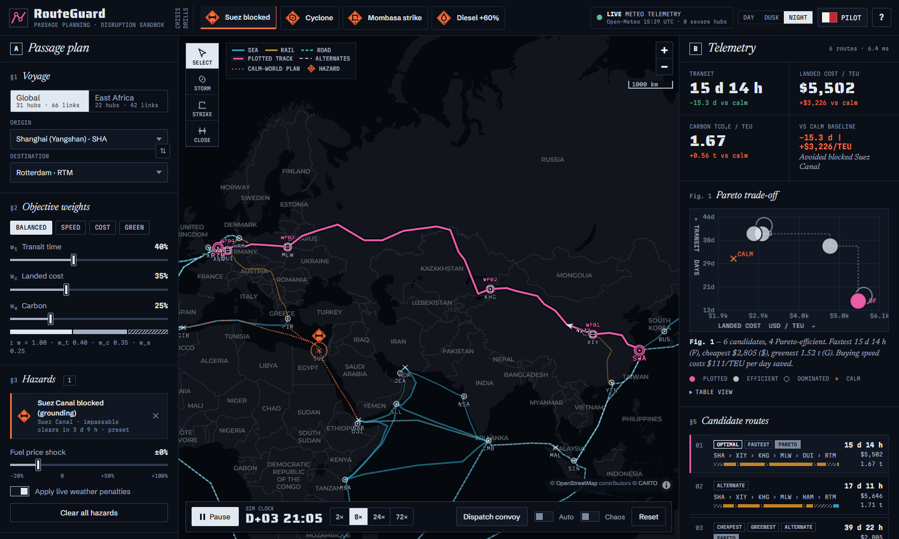
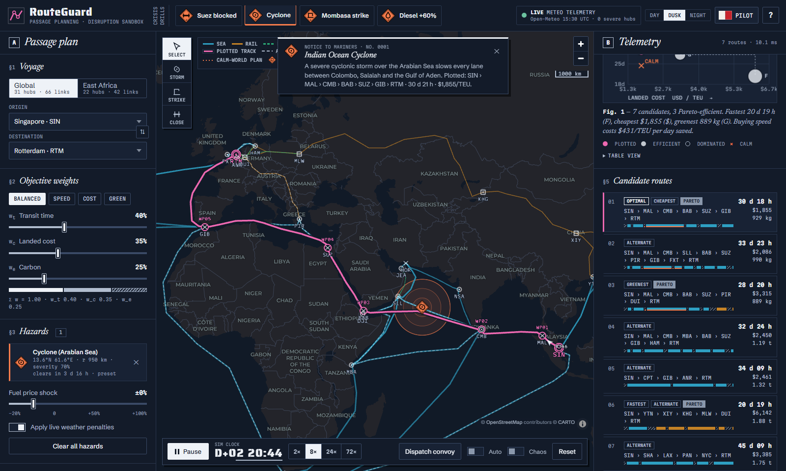
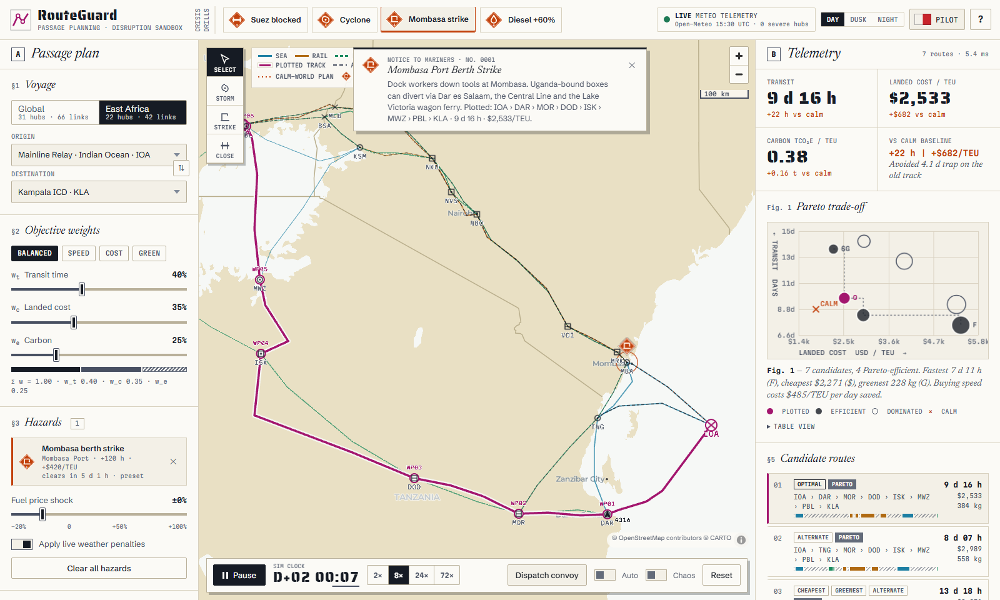
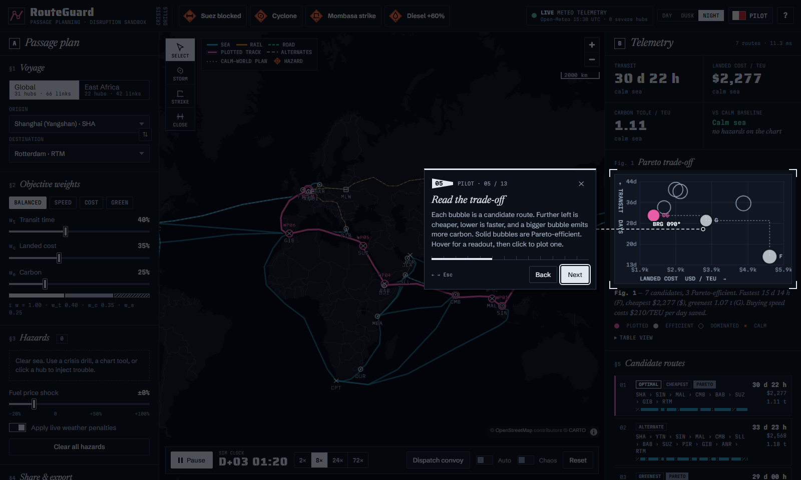
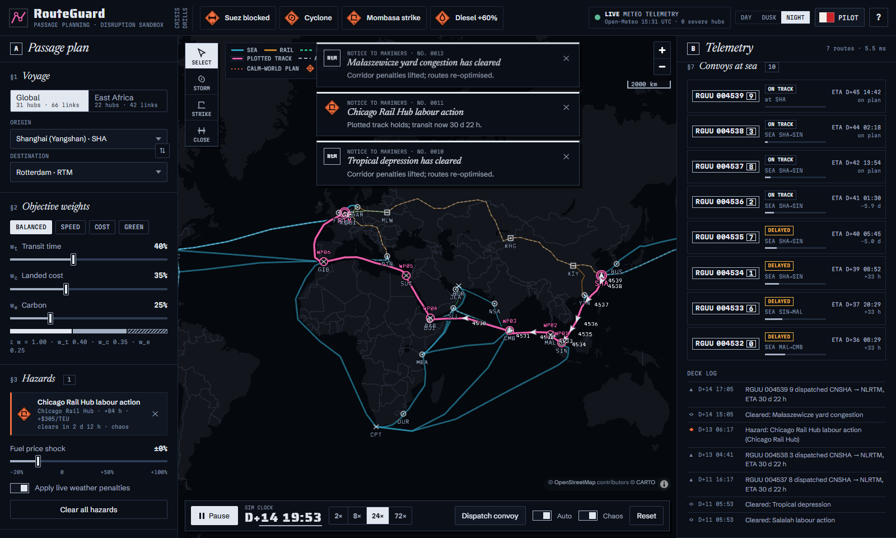
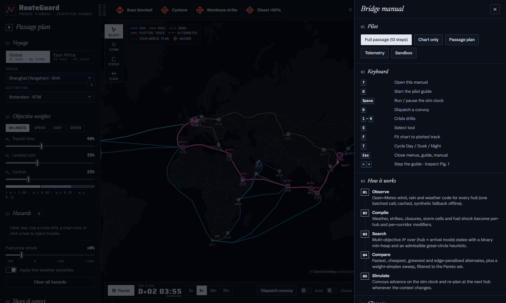
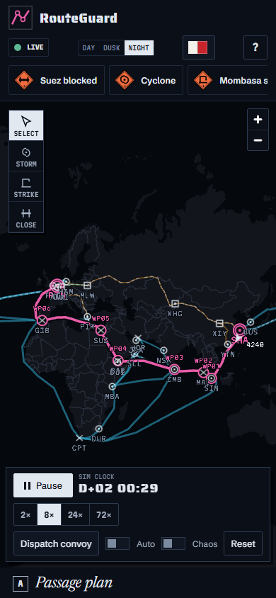

# RouteGuard — Geospatial Supply-Chain & Logistics Disruption Simulator

An interactive 2D logistics command centre built with **MapLibre GL JS 4.7.1** and **Deck.gl 8.9.35**. Plot cargo routes across ports, rail corridors and highways, inject real disruptions such as live **Open-Meteo** weather, port strikes, chokepoint closures and fuel shocks, and watch a **multi-objective A\*** engine re-plot the optimal passage in a few milliseconds. A **live sandbox** runs a simulation clock: convoys sail, hazards appear and clear, and every convoy re-plans itself at its next hub.

Zero build, zero API keys. Open `index.html` through any static server, or deploy to GitHub Pages as-is.



> *Fig. 1 — Night palette, Suez Canal Blockage drill. The magenta plotted track has moved onto the Xi'an → Khorgos → Małaszewicze rail land bridge. The dotted orange line is the calm-world plan the closure invalidated. The Pareto chart puts the new plan (●) at −15.3 days against the calm baseline (×), for +$3,226/TEU.*

---

## Contents

1. [Quick start](#quick-start)
2. [Try it: the live sandbox](#try-it-the-live-sandbox)
3. [System architecture](#system-architecture)
4. [Multi-objective A\*: the mathematics](#multi-objective-a-the-mathematics)
5. [Live Open-Meteo integration](#live-open-meteo-integration)
6. [Disruption model](#disruption-model)
7. [Design: "Night Bridge"](#design-night-bridge)
8. [Testing](#testing)
9. [Deploying to GitHub Pages](#deploying-to-github-pages)
10. [Data notes and limits](#data-notes-and-limits)

---

## Quick start

```bash
npm start            # zero-dependency static server → http://localhost:4173
```

You can use any static server (`python -m http.server`, VS Code Live Server and so on). ES modules don't load from `file://` in most browsers, so serve the folder rather than double-clicking `index.html`.

For development only, to run the tests:

```bash
npm install          # installs @playwright/test
npm test             # engine unit tests (node:test)
npm run test:e2e     # Playwright end-to-end tests
npm run screenshots  # regenerates docs/screenshots/*
```

## Try it: the live sandbox

The simulator starts running. One convoy is already at sea on the plotted Shanghai → Rotterdam track, and the sim clock advances 8 sim-hours per second.

| Do this | What happens |
| --- | --- |
| Press **1** (*Suez Canal Blockage*) | The canal closes. The track re-plots in under 16 ms, the calm-world plan stays as a dotted ghost, and the convoy at sea re-plans at its next hub (Cape route) or holds position if the closed node is directly ahead. |
| Press **2** (*Indian Ocean Cyclone*) | A drifting storm cell crosses the Arabian Sea. Every lane it intersects slows in proportion to how much of the lane lies inside the cell. |
| Press **3** (*Mombasa Port Berth Strike*) | Switches to the East Africa network. Kampala-bound cargo diverts through Dar es Salaam, the Central Line and the Lake Victoria wagon ferry. |
| Press **4** (*Diesel +60%*) | Trucking and fast mainline shipping costs jump. Watch $/TEU and the Pareto frontier move. |
| Click any hub | Set origin or destination, inject a strike or gridlock, close it, or drop a storm on it. |
| **Storm / Strike / Close** tools | Click anywhere on the chart to inject your own trouble. |
| Toggle **Chaos** | Random strikes, storms and closures spawn every few sim-days and clear on their own. |
| Toggle **Auto** | Dispatches a convoy every 36 sim-hours. |
| Press **G** | The pilot guide (13 steps) walks through everything. **?** opens the manual. |

## System architecture

```
index.html ─┬─ css/styles.css                     Night/Dusk/Day tokens, console layout, signature components
            └─ js/main.js                         state, recalculation pipeline, frame loop, URL hash, manifest, keys
                 ├─ js/data/corridorNetwork.js    two graph presets (Global 31/66, East Africa 22/42) + geometry
                 ├─ js/engine/pathfinder.js       BinaryMinHeap · multi-objective A* · alternates · Pareto sweep
                 ├─ js/engine/disruptionEngine.js Open-Meteo fetcher · Beaufort · disruption compiler · presets · chaos
                 ├─ js/engine/simulation.js       sandbox clock · convoy state machine · reroute / hold logic
                 ├─ js/engine/iso6346.js          container numbers with valid check digits
                 ├─ js/map/mapRenderer.js         MapLibre basemap re-tint + Deck.gl MapboxOverlay layer stack
                 ├─ js/ui/telemetryCharts.js      high-DPI canvas Pareto chart · proportional leg strips
                 ├─ js/ui/pilot.js                first-run guide (coach marks)
                 └─ js/ui/format.js               formatting + count-up
```

**Recalculation pipeline**, run on every change to weights, hazards, fuel, weather or voyage:

1. **Observe**: Open-Meteo current conditions for every hub, in one batched request.
2. **Compile**: `compileContext()` folds weather, strikes, closures, storm cells and fuel shock into per-node and per-edge modifiers (`closed`, `speedFactor ≤ 1`, `co2Factor ≥ 1`, `delayHours`, `surchargeUsd`).
3. **Search**: `solveScenario()` runs optimal, fastest, cheapest and greenest solves, K = 4 edge-penalised alternates and a 21-point weight-simplex sweep, then de-duplicates and filters to the Pareto set. It also computes the calm-world baseline and *what the old plan costs now*. A full solve of 30-plus A* runs takes **4–20 ms** on a laptop.
4. **Render**: Deck.gl layers update through prop diffing. Corridor arrays are memoised per context version, so GPU attributes rebuild only when the hazard picture changes.
5. **Simulate**: `Sandbox.onContextChanged()` re-times or re-plans every convoy in flight.

**Deck.gl layer stack** (bottom → top): storm cells as pulsing isobar rings (`ScatterplotLayer`, metres) · corridors by mode, width scaled by TEU/week capacity (`PathLayer`, roads dashed with `PathStyleExtension`) · closed corridors · the calm-world ghost · alternates (dashed) · plotted-track casing + chart-magenta core (a `TripsLayer` draw-on animation when it changes) · waypoint circles and `WPnn` labels · hub glyphs (`IconLayer`, GPU-tinted masks) · hub codes · Beaufort flags · hazard placards · convoy chevrons with ISO 6346 serials. Every path uses `wrapLongitude`, so the transpacific lanes cross the antimeridian cleanly.

## Multi-objective A\*: the mathematics

**Graph.** Directed multigraph $G=(V,E)$ with modes $m(e) \in \{\text{MARITIME}, \text{RAIL}, \text{ROAD}\}$. Edges are bidirectional, and parallel edges of different modes are allowed (e.g. LAX–CHI by rail and by road).

**State space.** A modal transfer penalty depends on *how you arrived*, so search runs over states $s=(v, \mu)$, where $\mu$ is the arrival mode. Keying on nodes alone would silently drop optimal paths. This doubles as a time-expanded "mode layer" graph.

**Leg metrics.** Leaving node $u$ (reached by mode $\mu$) along edge $e$ to $v$:

$$
\begin{aligned}
H_e &= \frac{d_e}{v_e\,\sigma_e} \;+\; \delta_u(\mu, m_e) \;+\; \tau_{\mu\to m_e} \;+\; \Delta^{H}_u \;+\; [v{=}t]\,(\text{dwell}_v + \Delta^{H}_v)\\
C_e &= d_e\,c_e\,\phi(e) \;+\; h_u(\mu, m_e) \;+\; \kappa_{\mu\to m_e} \;+\; \Delta^{C}_u \;+\; [v{=}t]\,(h_v + \Delta^{C}_v)\\
E_e &= d_e\,\varepsilon_e\,\rho_e \;+\; \eta_{\mu\to m_e}
\end{aligned}
$$

| Symbol | Meaning |
| --- | --- |
| $d_e$ | corridor length: great-circle sum of waypoints × tortuosity ≥ 1 |
| $v_e,\ \sigma_e \le 1$ | base speed; weather/storm speed factor |
| $\delta_u$ | terminal call: full dwell at origin, at a modal transfer or at a chokepoint queue; 35 % dwell when passing through on the same mode |
| $\tau, \kappa, \eta$ | modal transfer penalty in hours, USD and CO₂e, e.g. sea→rail = 10 h, $120, 9 kg |
| $\Delta^H, \Delta^C$ | strike / congestion delay and surcharge |
| $\phi(e) = 1 + s\cdot f_m$ | fuel multiplier; shock $s\in[-0.2, 1]$, fuel share $f$ = 0.42 road, 0.38 fast sea, 0.26 slow sea, 0.14 rail |
| $\rho_e \ge 1$ | weather drag on emissions |

A closure sets $H_e = C_e = E_e = \infty$: the edge is skipped and the graph is structurally re-routed.

**Scalarisation.** With slider weights auto-normalised so $w_t + w_c + w_e = 1$, and baseline network scales $\hat H, \hat C, \hat E$ (mean undisrupted leg metrics):

$$
J(e) = w_t\,\frac{H_e}{\hat H} + w_c\,\frac{C_e}{\hat C} + w_e\,\frac{E_e}{\hat E}
$$

**Admissible, consistent heuristic.** Let $g(n)$ be the great-circle (haversine) distance from $n$ to the goal:

$$
h(n) = g(n)\left[\frac{w_t}{v_{\max}\hat H} + \frac{w_c\, c_{\min}\,\phi_{\min}}{\hat C} + \frac{w_e\,\varepsilon_{\min}}{\hat E}\right]
$$

Every edge is at least as long as the straight line between its ends (tortuosity ≥ 1). No disruption can make an edge faster ($\sigma \le 1$), cheaper per km than $c_{\min}\phi_{\min}$, or cleaner than $\varepsilon_{\min}$ ($\rho \ge 1$), and every penalty is non-negative. So $h$ never overestimates, and the triangle inequality of the great-circle metric makes it consistent. **A\* therefore returns exactly the scalarised optimum.** The unit tests check this against Dijkstra ($h \equiv 0$) on up to 80 random O/D/weight combinations under storm and fuel-shock contexts.

**Priority queue.** `BinaryMinHeap` is an indexed binary heap with a position map, giving `push`, `pop` and `decreaseKey` in $O(\log V)$.

**Alternatives and Pareto set.**
- *Fastest*, *cheapest* and *greenest*: single-objective solves with weights (1,0,0), (0,1,0) and (0,0,1).
- *Edge-penalised K-shortest paths* (the iterative penalty method): after each solve, multiply the cost of the edges just used by 1.6 and re-solve. The resulting route is then re-evaluated under the honest, unpenalised context.
- *Simplex sweep*: solve at 21 weight vectors on a 1/5 grid of the simplex.
- Merge and de-duplicate by edge signature, then keep the non-dominated set over (hours, USD/TEU, kg CO₂e). Fig. 1 draws the 2-D cost/time frontier as a staircase, with bubble area proportional to CO₂e.

**Baseline deltas.** The KPI header compares the plotted route with the *calm-world* optimum (no hazards, no fuel shock, no weather). It also re-evaluates the calm plan under today's hazards, which is where *"Avoided 4.1 d trap on the old track"* and *"Avoided blocked Suez Canal"* come from.

## Live Open-Meteo integration

- **Endpoint:** `https://api.open-meteo.com/v1/forecast?latitude=…&longitude=…&current=temperature_2m,wind_speed_10m,precipitation,weather_code`. This is a single request with comma-separated coordinates for all hubs (31 or 22), and it needs no API key.
- **Severity → penalties** (`weatherImpact`):
  - wind > 45 km/h (about Beaufort 7, *near gale*): maritime speed −12 % to −40 %, and roads lose about a third of that;
  - precipitation ≥ 4 mm or heavy-rain/snow WMO codes: roads −22 %, rail −8 %, sea −6 %;
  - thunderstorm codes 95–99: sea −15 %, roads −12 %.

  Conditions at a terminal affect roughly the first or last fifth of each leg.
- **Status badge** reads `LIVE`, `CACHED` or `SYNTHETIC` (the lamp is green, amber or hollow) and shows the fetch time and the number of severe hubs. Click it to refresh.
- **Fallbacks:** results are cached in `localStorage` for 30 minutes. If the network fails, the cache is used. With no cache, a deterministic synthetic sea state (seeded by hub and UTC hour) keeps the simulator working offline. Every storage call is wrapped in `try/catch`.
- Hub hover cards show live temperature, wind (km/h and Beaufort force), WMO weather description and precipitation. Severe hubs get an `F7`/`TS`/`RA` flag on the chart.

## Disruption model

| Class | Kind | Effect | Where |
| --- | --- | --- | --- |
| 1 | **Congestion / strike** | +24 to +120 h dwell and a USD surcharge on anything calling at or passing the hub | node |
| 2 | **Closure / blockade** | impassable (`∞`); in-flight convoys heading for it hold position | node or corridor |
| 3 | **Storm cell** `[lng, lat, radiusKm]` | speed falls in proportion to the fraction of each leg inside the circle; sensitivity: sea 1.0, road 0.6, rail 0.25. Cells can drift. | area |
| 4 | **Fuel shock** −20 % to +100 % | line-haul × (1 + shock × fuel share): road and fast mainline sea hit hardest | global |

Each hazard can carry a duration in sim-hours and clears itself on the sandbox clock. All hazards are encoded in the URL hash, so **Copy scenario link** reproduces the exact chart. **Route manifest (JSON)** exports the voyage, weights, hazards, weather status, every leg (hours split into line-haul, terminal and transfer, plus $/TEU, CO₂e and alerts), all candidates, the calm baseline and the convoys at sea.

## Design: "Night Bridge"

The product resembles a **ship's bridge running an ECDIS passage plan**, so every visual decision traces back to that system rather than to a generic dashboard.

| Reference | What it became |
| --- | --- |
| **IHO S-52 ECDIS Presentation Library**, which defines separate Day, Dusk and Night colour tables so the display can be read at night without losing dark adaptation ([IHO S-52](https://iho.int/uploads/user/pubs/standards/s-52/S-52%20Edition%206.1.1%20-%20June%202015.pdf), [IHO ENC portrayal](https://iho.int/en/enc-portrayal)) | The **Day · Dusk · Night** palette switch (key **T**). Each palette is a full token set plus a re-tint of the CARTO basemap. Day uses chart buff land and near-white sea, like a paper chart. Night is near-black and dimmed. |
| **Chart magenta**: on US and Admiralty charts, magenta marks what a navigator must act on, such as lights and regulated areas ([NOAA Chart No. 1](https://webarchive.library.unt.edu/web/20130215205428/http:/www.nauticalcharts.noaa.gov/mcd/chart1/ChartNo1.pdf), [Admiralty chart](https://en.wikipedia.org/wiki/Admiralty_chart)) | The one signal colour, **reserved for the plotted track**: route line, waypoint circles, `WPnn` labels, the plotted point in Fig. 1 and the selected candidate. No button or decoration uses it. |
| **Passage-plan convention**: waypoints drawn as circles and numbered along a planned track | Waypoint rings with `WP01…` labels; a track **casing** instead of a glow; a `TripsLayer` "plotting" draw-on whenever the track changes. |
| **IMDG dangerous-goods placards**: a 45° diamond with a symbol at the top and the class number in the bottom corner ([IMDG labels](https://shashikallada.com/imdg-code-labels-and-placards/)) | **Hazard placards** for the four disruption classes (1 strike, 2 closure, 3 storm, 4 fuel), used on the chart, the crisis drills, the hazard list, toasts and the legend. |
| **ISO 6346 container numbers**: owner code, category, serial and a check digit computed mod 11 ([ISO 6346](https://en.wikipedia.org/wiki/ISO_6346), [BIC calculator](https://www.bic-code.org/check-digit-calculator/)) | Every convoy carries a **valid** number (owner `RGUU`), shown as a stencilled plate with the check digit boxed, as it is painted on real boxes. |
| **Beaufort scale**, the WMO / Met Office wind-force bands ([Met Office](https://www.metoffice.gov.uk/weather/guides/coast-and-sea/beaufort-scale)) | Live wind becomes `F0–F12` flags on the chart and in hover cards; the severity threshold sits at about force 7. |
| **International Code of Signals**: flag **G** means "I require a pilot" and **H** means "I have a pilot on board" ([ANBG signal meanings](https://www.anbg.gov.au/flags/signal-meaning.html)) | The first-run guide is a **pilot**. The opt-in invitation flies flag G and the persistent guide key flies flag H. Steps are numbered on pennants. |
| **ECDIS EBL / pick report**: an electronic bearing line from own ship plus bracketed cursor pick reports | Guide cards point at their target with a dashed **EBL** and a live `BRG 270°` readout. Spotlights and hover cards use corner **pick-report brackets**. |
| **Notices to Mariners**: numbered official corrections to charts | Toasts are numbered *"Notice to Mariners · No. 0007"*. |
| **Control-tower UIs** (project44 Movement's disruption map, Flexport's "watchtower" dashboard) ([project44](https://www.project44.com/blog/project44-enhances-movement-platform-with-new-capabilities-to-help-customers-mitigate-supply-chain-disruption/), [Flexport UX](https://medium.com/flexport-ux/the-flexport-dashboard-2-0-2524f8e92245)) | Inputs on the left, the chart in the middle, outcomes on the right; disruptions shown *on the map*, with the impact on in-flight convoys spelled out in the deck log. |
| **NN/g onboarding research**: pushed tutorials didn't improve task success and made tasks feel harder ([NN/g mobile tutorials](https://www.nngroup.com/articles/mobile-tutorials/), [NN/g onboarding](https://www.nngroup.com/articles/mobile-app-onboarding/)) | The guide is **opt-in** ("Embark pilot / Not now"), offered once, never forced, and always reachable with **G**, the header key, or the manual's per-panel mini tours. |

**Typography.** *Newsreader Italic* for headings follows the hydrographic convention of italic lettering for water features. *Schibsted Grotesk* is the UI text face. *Martian Mono* (width axis set to 87.5 %) handles labels and data, and *Saira Stencil One* is used for the KPIs, the sim clock and the brand, after container stencils. The single-weight stencil face sets `font-synthesis: none`, so it is never faux-bolded.

**Colour discipline.** The mode colours were validated with the dataviz palette validator: sea `#2E9FC2`, rail `#C58226`, road `#2AAA77` on Night/Dusk; `#1D7FA3 / #B06A12 / #1A8A5E` on Day. They pass lightness band, chroma, CVD separation (ΔE 9.3 deutan) and contrast checks. Day mode has a CVD warning band, so **roads are also dashed** everywhere: on the chart, in the legend, the leg strips and the mode badges. Hazards are a muted orange-red, delays and holds amber, and good news a muted green.

**Motion with meaning.** Track draw-on when re-plotted · pulsing isobar rings on storm cells and hazard rings on struck hubs · drifting cyclones · convoy chevrons heading along their legs · KPI count-ups · a sweep under the sim clock while it runs · a rotating EBL on the warm-up compass rose. Everything is disabled under `prefers-reduced-motion`, which also leaves the clock paused until you press Run.

**States.** Warm-up ("Taking bearings…"), offline graticule chart fallback, chart-display fault card (if the CDN is blocked), *No passage* empty states, empty hazards / convoys / log, and a themed [404](404.html) ("You have sailed off the chart").

### First-run guide (pilot)

- Invitation shown once (`localStorage`, `try/catch`): **Embark pilot** or **Not now**.
- 13 steps: chart → voyage → weights → plotted track & KPIs → Pareto → crisis drills → chart tools → hazards → sandbox console → convoys & deck log → leg breakdown → share/export → where to reopen.
- Cut-out veil built from four panes, so the target stays clickable · bracketed spotlight · EBL leader with bearing · `n / N` and a sounding-scale progress bar · Back / Next / Disembark · ✕ · ←/→/Esc · focus moves into the card with a focus trap · `aria-live` announcements · repositions on resize and scroll (rAF loop) · scrolls targets into view below the sticky header · docks to the top or bottom on phones.
- **Help drawer (`?`)**: full tour plus per-panel tours (chart, plan, telemetry, sandbox), keyboard map, a five-step "how it works" pipeline, and a glossary (TEU, landed cost, dwell, modal transfer, chokepoint, Pareto, A\*, Beaufort, SGR/MGR, ICD, ISO 6346, S-52 palettes).

### Screens

| | |
| --- | --- |
|  |  |
| *Dusk · Indian Ocean Cyclone: a drifting cell over the Arabian Sea* | *Day · Mombasa strike: diverted via Dar es Salaam, the Central Line and the Lake Victoria ferry* |
|  |  |
| *Pilot guide: pennant step, EBL bearing, bracketed spotlight* | *Chaos mode: Bab-el-Mandeb closes and seven convoys re-plan via the Cape* |
|  |  |
| *Bridge manual (`?`)* | *Phone, 390 px* |

## Testing

- **Unit (`npm test`)**, 10 tests: network size and schema invariants (including *edge length ≥ great-circle distance*), heap ordering and `decreaseKey`, **A\* = Dijkstra** on 80 random cases, Suez structural reroute, Mombasa diversion, scenario solve with a Pareto set in under 250 ms, storm intersection, Beaufort bands, ISO 6346 check digits, convoy hold/reroute/delivery, and congestion re-timing.
- **E2E (`npm run test:e2e`)**, 11 Playwright tests: load with no console errors · Suez drill re-plot + verdict + toast + hash · Pareto keyboard readout and click-to-plot · **guide invite → tour across panels → Esc → never shown again → reopen** · help drawer (`?`, Esc, partial tour) · sandbox clock / dispatch / chaos / speed / reset · map hub hover card → pick menu → strike · scenario link round-trip · manifest JSON download · **390 px with no horizontal overflow and a docked guide** · themed 404. Functional tests pre-mark the guide as seen.

## Deploying to GitHub Pages

1. Push the repository to GitHub. No build step; `node_modules/` is git-ignored and not needed at runtime.
2. **Settings → Pages → Build and deployment → Source: Deploy from a branch**, then choose `main` and `/ (root)`.
3. Wait for the Pages workflow, then open `https://<user>.github.io/<repo>/`. All paths are relative, the CDNs (unpkg, Google Fonts, CARTO, Open-Meteo) are CORS-friendly, and `404.html` is picked up automatically.

## Data notes and limits

- Coordinates, corridors and the East African network (Kenya SGR Mombasa–Nairobi–Naivasha, revived MGR to Malaba and Kisumu, the Tanzania SGR and Central Line, Lake Victoria wagon ferries, border posts at Malaba, Busia, Katuna and Rusumo) are real. Waypoints are simplified to stay on water or on the corridor.
- Speeds, $/TEU-km rates, dwell times and CO₂e factors are **plausible order-of-magnitude figures** chosen for a simulator, e.g. mainline sea ≈ $0.085/TEU-km and 55 g CO₂e/TEU-km, road ≈ $1.4–2.6/TEU-km and 620–720 g. They are not quotes. Edit `PROFILE` in `corridorNetwork.js` to tune them.
- Basemap © OpenStreetMap contributors © CARTO. Weather: Open-Meteo.com (CC BY 4.0).
